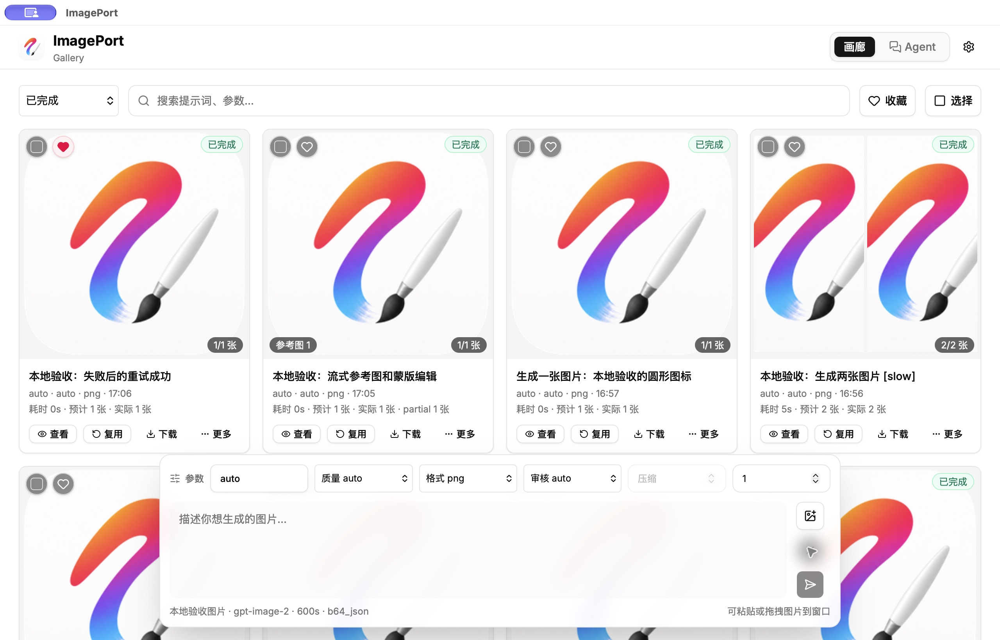

# 图片工作台验收记录

日期：2026-11-07。环境：macOS / Apple Silicon，当前工作区；本地构建版本沿用 0.1.8，未发布。

本轮完成图片主线收敛、设置兼容、首批结构整理和历史媒体按需读取，并在隔离的 Tauri 预览应用中验证核心流程。正式应用标识、已安装应用和真实运行数据未被替换。

## 自动检查

| 检查 | 结果 |
| --- | --- |
| `bun test` | 247 通过，0 失败，43 个文件，851 次断言 |
| `bun run check` | 0 错误、0 警告 |
| `bun run lint:oxc` | 通过 |
| `cargo check --manifest-path src-tauri/Cargo.toml` | 通过 |
| `cargo fmt --manifest-path src-tauri/Cargo.toml -- --check` | 通过 |
| `cargo test --manifest-path src-tauri/Cargo.toml --lib` | 3 通过，0 失败 |
| `bun qa/image-workbench-sql.ts` | 真实 SQLite 验证通过：列表省略原始响应，收藏更新保留原始响应及文件引用 |
| `bun run release:check v0.1.8` | 版本一致性检查通过；没有创建 tag 或发布 |
| `git diff --check` | 通过 |

实施前为 306 个前端测试。数量减少包含退役的 Studio/视频测试和 4 个不能反映连接池行为的事务 mock；存储事务改为 3 个 Rust/SQLite 测试，覆盖跨连接可见性、中途失败整批回滚以及 Agent/任务表互不覆盖。另加入设置迁移、按需媒体读取、迟到响应、取消与分页合并等回归用例。

全仓库 `bun run format:check` 仍报告 6 个原有文件的格式问题：`agent-runtime.ts`、`agent-runtime.test.ts`、`task-selection.ts`、`task-state.test.ts`、`update-check.ts`、`external-link.test.ts`。这 6 个文件的 SHA-256 与实施前源码归档完全相同；本轮保留其内容。新增和本轮实际修改的 32 个前端及 QA 文件单独格式检查通过。

## 原生桌面流程

使用独立标识 `run.jiewen.imageport-desktop.preview`、26 条初始化历史、两个模拟 API Profile，以及仅监听 `127.0.0.1:23361` 的本地接口。图片固定返回仓库图标，未调用真实收费接口，也未使用真实 API Key。

| 流程 | 观察结果 |
| --- | --- |
| 首次打开、分页 | 首屏 24 / 26 条；画廊和 Agent 为两个主入口，没有 Studio 初始化或视频入口 |
| 两张图片生成、切换模式 | 生成中切到 Agent，回到画廊后显示 2 / 2；没有因切换重复提交 |
| Agent 对话及图片生成 | 推理、独立图片 Profile 分工有效；图片结果关联画廊任务 |
| Agent 停止与迟到结果 | 停止后保持终态，模拟接口晚到的图片不覆盖已停止任务 |
| 流式参考图及蒙版 | 历史输出设为参考、绘制并保存蒙版、显示 partial 和最终结果；接口记录为 edits、stream=true、references=1、mask=true |
| 失败、复用与重试 | 模拟 503 后保留失败任务和原因；复用参数、修改提示词后成功生成 |
| 查看详情 | 重启后的轻量历史按需恢复原图、参考图及 partial |
| 完整 ZIP 备份 | 从仅加载 27 / 29 条历史的状态导出，ZIP 含全部 29 条及 Agent 会话，包含未加载的旧任务；ZIP CRC 检查通过 |
| ZIP 合并恢复 | 恢复缺失的 2 条、跳过 27 条重复任务；从另一数据库连接确认已提交，重启后仍存在 |
| 运行中退出、再次启动 | 显示“任务在应用关闭或刷新时中断”；草稿、收藏与 Agent 对话恢复；模拟接口请求计数未因重启增加 |
| 旧 Studio 数据保留 | 共享库旧表、独立 Studio 库及媒体标记文件均保留 |

原生验收过程中发现旧实现用连接池的多次执行拼接事务，导致部分整批写入没有真正提交。本轮改为 Rust 持有同一连接的原子事务，并重新完成备份恢复和重启验证。



## 历史读取对比

从实施前的真实数据归档副本只读测量：共 295 条历史，比较同一首屏 24 条。运行 `bun qa/image-workbench-benchmark.ts /绝对路径/归档数据目录` 可复测。副本通过 immutable SQLite 连接读取，不修改用户数据库。

| 指标 | 完整水合 | 列表预览 |
| --- | ---: | ---: |
| SQLite 返回的任务 JSON 字节 | 88,369,427 | 46,044 |
| 读取图片文件次数 | 129 | 42 |
| 图片文件读取字节 | 111,732,154 | 13,782,389 |
| 媒体字符串字符数 | 148,979,262 | 36,755,008 |

首屏图片文件读取量减少 **87.66%**。大体量 Provider 原始响应留在数据库中，详情再读，任务 JSON 传输量下降约 99.95%。列表不加载原图、参考图和蒙版；旧记录没有缩略图时兼容回退原图。

该测量不含 Tauri 文件桥、WebView 渲染和冷启动，文件系统缓存也会影响耗时；不能据此宣称启动提速倍数或内存下降幅度。冷启动、空闲内存和持续滚动的实机性能基线仍需补充。

同一份真实旧设置的 14 个 Profile 全部保留，凭据比较一致，设置归一化为 schema 2；验证记录只保存数量与布尔结果。

## 本地打包

`bun run tauri build --bundles app,dmg` 通过，正式配置下的 `ImagePort.app` 与 `ImagePort_0.1.8_aarch64.dmg` 已生成，应用标识为 `run.jiewen.imageport-desktop`。`hdiutil verify` 验证 DMG 校验和有效。此前相同代码还通过独立标识的预览 `.app` 原生流程验收；正式标识安装包没有启动或安装，以免改写真实使用中的数据。

| 产物 | 大小 |
| --- | ---: |
| 前端静态构建总字节 | 5,948,659 |
| 前端 JavaScript 总字节 | 660,855 |
| 最大 JavaScript 文件字节 | 526,063 |
| macOS `.app` 文件总字节 | 26,899,887 |
| DMG 字节 | 15,675,544 |

实施前 JavaScript 为 918,289 字节，本轮降至 660,855 字节，减少约 28%。原生包没有同条件的实施前构建数据，因此不报告安装包缩小比例。

产物位于 `src-tauri/target/release/bundle/`。DMG SHA-256：

```text
45d54d37a1abcf5295389d02ec0f6e4d71266b468cf856a54d5ec1fe1d4b6907
```

## 归档与已知边界

源码归档以实施前工作区为准，包含当时已修改与未跟踪文件。运行数据使用数据库一致性快照并处理 WAL；压缩包逐一校验 2009 个文件、3,181,396,899 字节，大小及 SHA-256 均匹配。位置及恢复说明见[升级说明](image-workbench-upgrade.md)。

尚未完成的验收与后续工作：

- 真实 OpenAI、xAI、Gemini、自定义网关的付费请求矩阵；现有协议单元测试通过不等同于线上接口验收。
- Windows / Linux 构建及实机流程；本轮仅有 macOS Apple Silicon 环境。
- 系统剪贴板、拖拽、单图和批量保存的完整平台矩阵，以及大尺寸真实图片的蒙版精度。
- GB 级应用内 ZIP 备份仍使用 WebView 内存；原生目录归档已验证，但不能替代 ZIP 的内存压力验收。流式或分卷备份后续实现。
- Gallery 内剩余的 Agent、参考图和导入导出编排继续按职责小批次拆分；本轮已提取生成任务控制、媒体读取、任务工厂、结果归一化，以及偏好和数据设置面板。
- 发布前选择新版本号，按发行渠道处理签名、公证及更新验证；本地安装包不代表已对外发布。
