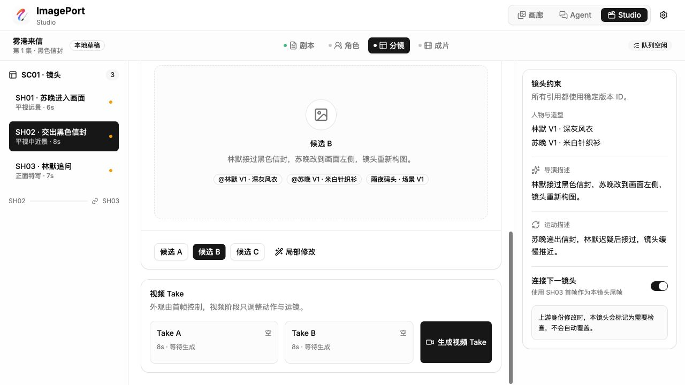
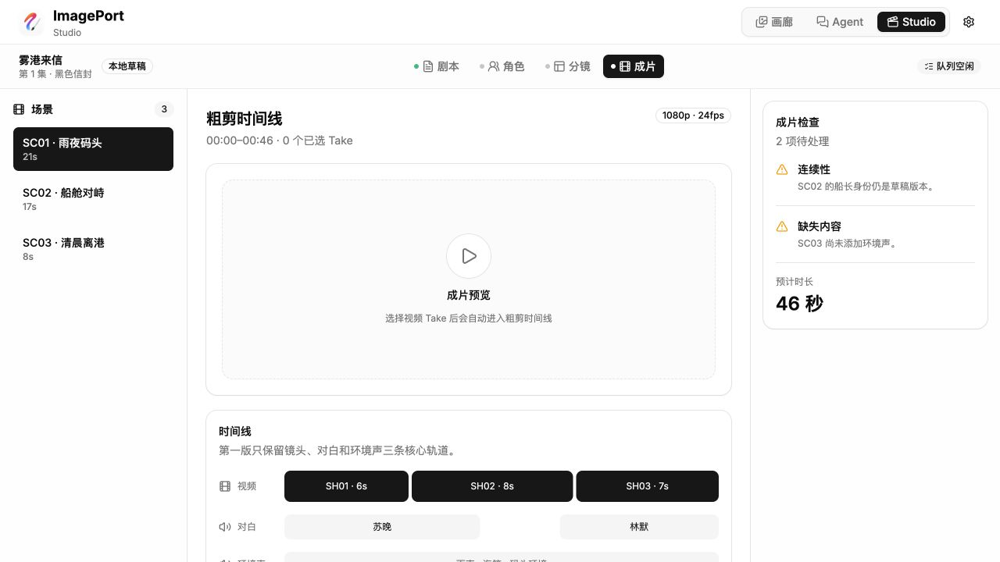

# ImagePort Studio Flow Audit

Date: 2026-07-15\
Surface: local ImagePort Studio prototype\
Primary user goal: start from a story idea, establish stable character/scene assets, generate coherent shots and video Takes, then assemble a cut without invalidating downstream work.

## Overall verdict

The interface has useful production concepts, but the current state model is not coherent enough to support the promised workflow. The main issue is not visual density. Upstream and downstream objects are pre-created at the same time, while `editable`, `generated`, `locked`, and `stale` are not enforced as mutually meaningful states. This makes several calls to action contradict the screen around them.

Recommended direction: replace the four loose tabs with a dependency-aware pipeline—`创意 → 剧本 → 资产 → 镜头 → 成片`—and make every generated object follow one state machine: `empty → draft → generating → review → locked → stale`.

## Captured flow

### 1. Studio entry opens on a locked character

Health: unhealthy entry state.

- The navigation order begins with Script, but entering Studio opens Character.
- Identity V1 is shown as locked while its defining description, identity anchors, and wardrobe remain directly editable.
- The page says regeneration creates a draft without overwriting locked versions, but editing fields already changes the current V1 source values.
- Three characters and downstream shot usage counts already exist, so the user never sees how a new project begins.

### 2. Script generation is project-level input inside a scene-level screen

Health: scope conflict.

- “Generate script draft” sounds project-wide, but it only updates the active scene.
- The left side already shows three scenes and shot counts before script generation.
- All scene assets are already ready, including locked character identities, so the intended dependency from script to assets is invisible.
- The later “confirm assets and split shots” action conflicts with shots that already exist.

### 3. Storyboard opens with a locked keyframe before generation

Health: understandable layout, invalid default state.

- The screen simultaneously shows “keyframe locked” and “generate three keyframes.”
- Existing shot candidates, prompts, bindings, and continuity links make it unclear what generation will create versus replace.
- The Storyboard stage includes both still-image approval and video production, hiding an important approval boundary.

### 4. Editing the frame prompt makes the keyframe a draft

Health: broken dependency transition.

- The header correctly changes to “keyframe draft,” but the previous selected candidate remains visible as if it matches the new prompt.
- Character, scene, and next-shot bindings do not show whether they are fresh, stale, or incompatible with the changed prompt.
- “Local edit” is presented as available but has no working interaction.

### 5. Video generation remains enabled for the draft keyframe

Health: critical state conflict.

- The selected candidate still displays the edited description without a new image having been generated.
- “Generate video Take” remains enabled even though the current keyframe is only a draft.
- This allows an expensive downstream job to start from an unapproved or stale upstream asset.

### 6. Cut shows a timeline with zero selected Takes

Health: output representation conflict.

- The header says zero selected Takes, while the timeline already shows three complete video blocks.
- The preview is empty, but the project duration and dialogue tracks look authoritative.
- Two warnings are shown, but the larger blocker—no selected video media—is not represented as the primary empty state.

## Highest-priority findings

### P1 — Locked identities are still mutable

Location: Character stage.

Impact: shots bound to `Identity V1` can silently change appearance while still claiming a stable version.

Recommendation: locked versions must be read-only. Any edit begins an explicit `V2 draft`; downstream shots continue referencing immutable V1 until the user migrates them.

### P1 — Draft keyframes can produce video

Location: Storyboard → Video Take.

Impact: downstream media can be generated from stale or unapproved frame state.

Recommendation: prompt edits mark candidates and Takes stale. Disable video generation until one newly generated candidate is explicitly approved and locked.

### P1 — Cut visualizes media that does not exist

Location: Cut stage.

Impact: users cannot tell whether the timeline represents generated footage, planned duration, or placeholders.

Recommendation: separate `planned shot track` from `selected media track`. With zero selected Takes, show an empty timeline and a direct route back to unresolved shots.

### P1 — Generation scope does not match its label

Location: Script stage.

Impact: “generate script” implies project creation but mutates one scene after scenes and shots already exist.

Recommendation: project-level Story Brief generates the screenplay structure. Scene-level controls should be labeled “rewrite this scene” and never create or imply the entire script.

### P2 — Entry point contradicts stage order

Location: Studio landing and top navigation.

Recommendation: open new projects on Project Brief. Open existing projects on an Overview screen with one explicit “continue from next unresolved step” action.

### P2 — Status dots and ready defaults hide blockers

Location: stage navigation and list items.

Recommendation: use named states and counts such as `3 characters need approval`, `2 stale shots`, and `0/7 Takes selected`; color remains secondary.

## Proposed information architecture

1. **Project Overview**
   - Project brief, target duration, visual language, model/provider choices.
   - One primary action: generate screenplay structure.
2. **Script**
   - Scene outline first, scene editor second.
   - Project action: regenerate outline; scene action: rewrite current scene.
3. **Asset Library**
   - Characters, locations, props.
   - Every asset has immutable versions and a clear approval state.
4. **Shot Board**
   - Shot plan and dependencies.
   - Each shot has two explicit gates: approve keyframe, then approve video Take.
5. **Cut**
   - Only selected Takes appear as media.
   - Missing Takes remain planned placeholders with direct repair links.

## Recommended state contract

Every generated object should use the same lifecycle:

`empty → draft → generating → review → locked → stale`

- Editing a locked object creates a new draft version.
- Upstream edits mark dependent objects stale; they do not overwrite them.
- Only locked objects can start dependent generation.
- Generated candidates enter review; the system never auto-locks one.
- Cut uses selected, locked Takes only.

## Accessibility risks and evidence limits

- Tiny colored dots communicate readiness without visible text, creating a color-only interpretation risk.
- Some disabled controls use very light gray text and may have contrast issues.
- Input labels are visible and the active stage has a strong selected state, which are good foundations.
- Screenshots cannot confirm keyboard order, focus visibility after scrolling, screen-reader announcements, or whether timed generation changes are announced. These require interactive accessibility testing after the flow is restructured.

## Recommended implementation order

1. Define the shared lifecycle and dependency rules in the domain layer.
2. Add Project Overview and make it the entry point.
3. Separate project-level script generation from scene rewriting.
4. Make locked asset versions immutable and add explicit draft versions.
5. Split keyframe approval from video Take generation.
6. Make Cut render only selected media and planned placeholders honestly.
